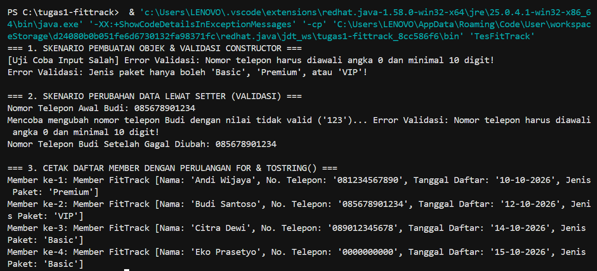

# Tugas 1: Sistem Keanggotaan Gym FitTrack

## Judul dan Identitas
* **Nama Tugas:** Remedial UTS Praktikum PBO - Tugas 1 (Sistem Keanggotaan Gym FitTrack)
* **Nama Lengkap:** Rahadatul Qudsi
* **NPM:** 250810701100026
* **Praktikum:** Pemrograman Berbasis Objek

## Deskripsi Singkat
Aplikasi ini dikembangkan untuk mendigitalkan sistem pencatatan data keanggotaan gym FitTrack yang sebelumnya manual. Program ini memastikan seluruh data member yang dimasukkan selalu valid melalui penerapan penanganan kesalahan dan prinsip OOP berbasis Java.

## Fitur Utama
1. **Pendataan Member Gym:** Menyimpan informasi nama, nomor telepon, tanggal pendaftaran, dan jenis paket keanggotaan.
2. **Validasi Input Otomatis:** Memastikan nomor telepon diawali angka 0 dan minimal 10 digit, nama tidak boleh kosong, serta jenis paket terdaftar secara valid.
3. **Konstruksi Fleksibel:** Menyediakan pilihan pembuatan akun member secara manual atau otomatis mengaktifkan paket *Basic*.
4. **Perlindungan Data (Data Safety):** Menolak data tidak valid pada perubahan (*setter*) tanpa merusak nilai lama yang sudah ada.

## Konsep OOP yang Diterapkan
| Konsep OOP | Lokasi Penerapan | Alasan Pemilihan |
| :--- | :--- | :--- |
| **Encapsulation** | Class `Member` (Atribut `private`, `getter/setter`) | Menyembunyikan data sensitif dan memastikan semua perubahan data diproses lewat fungsi validasi. |
| **Constructor Overloading** | Class `Member` | Memberikan fleksibilitas pendaftaran member dengan atau tanpa menentukan paket awal. |
| **Constructor Chaining (`this`)** | Class `Member` | Menghindari duplikasi kode pendaftaran (*DRY principle*). |
| **Method Overriding** | Method `toString()` pada class `Member` | Memberikan format cetak data yang jelas dan informatif saat objek diprint. |

## Struktur Project
```text
tugas1-fittrack/
├── .gitignore
├── README.md
└── src/
    ├── Member.java
    └── TesFitTrack.java
```

## Aturan Validasi

| Atribut | Aturan Validasi | Dampak Jika Gagal Validasi |
| :--- | :--- | :--- |
| **Nama** | Tidak boleh `null`, kosong, atau hanya berisi spasi (`!nama.trim().isEmpty()`). | Menampilkan pesan error validasi; data tidak diperbarui. |
| **No. Telepon** | Wajib diawali angka **`0`** dan memiliki panjang **minimal 10 digit**. | Menampilkan pesan error validasi; data lama tetap dipertahankan. |
| **Tanggal Daftar** | Tidak boleh `null` atau kosong. | Menampilkan pesan error validasi; data tidak diperbarui. |
| **Jenis Paket** | Hanya menerima pilihan: **`Basic`**, **`Premium`**, atau **`VIP`** (*case-sensitive*). | Menampilkan pesan error validasi; paket diisi/dipertahankan sesuai status sebelumnya. |

## Cara Menjalankan Program:
## Prasyarat
* **Java Development Kit (JDK)**: Versi 21
* **IDE (Disarankan)**: Visual Studio Code / IntelliJ IDEA / NetBeans

### Melalui Command Line (Terminal)

1. Clone Repository ini:
```bash
git clone [https://github.com/RahadatulQudsi/tugas1-fittrack.git](https://github.com/RahadatulQudsi/tugas1-fittrack.git)
cd tugas1-fittrack

Kompilasi program Java:
javac src/*.java

Jalankan program:
java -cp src TesFitTrack
```

###  Melalui IntelliJ IDEA / VS Code

1. Buka folder proyek `tugas1-fittrack` pada IDE pilihan Anda.
2. Pastikan SDK proyek telah diatur ke **JDK 21**.
3. Buka file `src/TesFitTrack.java`.
4. Klik tombol **Run** (atau tekan `Shift + F10` di IntelliJ / ikon tombol Play di VS Code).

---

## Contoh Output




## Nilai Default

| Atribut | Nilai Default | Keterangan |
| :--- | :--- | :--- |
| **Jenis Paket** | `"Basic"` | Jika instansiasi dilakukan tanpa menyertakan argumen jenis paket, sistem secara otomatis menetapkan paket sebagai **Basic**. |
| **Data Gagal Validasi** | `null` / Nilai Lama | Jika data pada *constructor* tidak lolos validasi, atribut bernilai `null`. Jika gagal pada *setter*, atribut mempertahankan **nilai lama**. |

## Batasan dan Pengembangan Lanjutan
### Batasan Saat Ini
* Data anggota masih disimpan di dalam memori utama (array/RAM) sehingga data hilang saat program dihentikan.
* Belum tersedia antarmuka pengguna interaktif (CLI Scanner / GUI) untuk memasukkan data secara dinamis dari keyboard.

### Rencana Pengembangan Lanjutan
* Mengintegrasikan media penyimpanan permanen (database MySQL atau file JSON/CSV).
* Menambahkan fitur penghitungan biaya keanggotaan berdasarkan jenis paket (Basic, Premium, VIP).
* Menambahkan antarmuka interaktif CLI berbasis menu pilihan bagi pengguna.

